


 

  


## Mario Ureña García

Data Science Engineering and Artificial Intelligence Engineering student. I work across data science, artificial intelligence, data engineering, cybersecurity and software development, turning data into useful insights and building intelligent, reliable systems.

I enjoy working with real-world datasets, graph theory, algorithms and security tooling, and I build projects that combine programming, mathematics, statistics and problem-solving. This GitHub documents my university work, experiments and personal builds.

**Focus areas:** Data Science, Artificial Intelligence, Data Engineering, Cybersecurity, Software Development

 

 
&nbsp;
&nbsp;
&nbsp;
&nbsp;
&nbsp;
&nbsp;

  
&nbsp;
&nbsp;
&nbsp;
&nbsp;
&nbsp;

  

**Languages and tools:** Python, C, SQL (MySQL, PostgreSQL, Supabase), Bash, Git, Linux, Microsoft Azure, Unity, VS Code, Claude Code, Emacs, Adobe Illustrator, Adobe Premiere Pro

 

 

 

 
<a href="https://github.com/MarioUrenaGarcia/MR-ATLAS"></a>
<a href="https://github.com/MarioUrenaGarcia/greenlens"></a>
<a href="https://github.com/MarioUrenaGarcia/grafos-active-directory"></a>
<a href="https://github.com/MarioUrenaGarcia/nmapVisual"></a>
<a href="https://github.com/MarioUrenaGarcia/MazeRunner"></a>
<a href="https://github.com/MarioUrenaGarcia/teleprompter"></a>
<a href="https://github.com/MarioUrenaGarcia/piedra-papel-tijera"></a>
<a href="https://github.com/MarioUrenaGarcia/atlas-data-science"></a>
<a href="https://github.com/MarioUrenaGarcia/ENDUTIH-BLOBS"></a>
<a href="https://github.com/MarioUrenaGarcia/LSB-Visualization"></a>
<a href="https://github.com/MarioUrenaGarcia/BattleShips"></a>
  

| Project | Description | Stack |
|---|---|---|
| [MR-ATLAS](https://github.com/MarioUrenaGarcia/MR-ATLAS) | Mixed reality app for Meta Quest 3 that controls omnidirectional robots, simulated or real over MQTT, with ArUco marker tracking | C#, Unity, OpenXR |
| [GreenLens](https://github.com/MarioUrenaGarcia/greenlens) ([docs](https://mariourenagarcia.github.io/greenlens/)) | Energy observability for local AI inference on Linux: measures CPU, memory and GPU energy per backend and model, reports kWh, gCO2e, cost and SCI | Go, TypeScript |
| [Grafos Active Directory](https://github.com/MarioUrenaGarcia/grafos-active-directory) ([site](https://mariourenagarcia.github.io/grafos-active-directory/)) | Active Directory modeled as a directed graph: access paths with BFS, Dijkstra, Tarjan and Brandes, and a minimal defense plan with max flow and min cut | Python, Jupyter |
| [nmap Visual](https://github.com/MarioUrenaGarcia/nmapVisual) | Local web interface for nmap with scan templates, live results, a network graph and suggested fixes, built only with the Python standard library | Python, JavaScript |
| [MazeRunner](https://github.com/MarioUrenaGarcia/MazeRunner) ([demo](https://mariourenagarcia.github.io/MazeRunner/)) | BFS, DFS, Dijkstra, greedy search and A* compared on a weighted grid map, first measured and then played against | Python, Jupyter |
| [Teleprompter](https://github.com/MarioUrenaGarcia/teleprompter) | Windows desktop teleprompter that floats above everything and stays hidden from screen sharing; reads PDF with OCR, Word, Markdown and text | C# |
| [Piedra, papel o tijera](https://github.com/MarioUrenaGarcia/piedra-papel-tijera) ([play](https://mariourenagarcia.github.io/piedra-papel-tijera/)) | Rock paper scissors with your webcam against a machine that never loses, using MediaPipe Hands in the browser | JavaScript |
| [Atlas de Data Science](https://github.com/MarioUrenaGarcia/atlas-data-science) ([site](https://mariourenagarcia.github.io/atlas-data-science/)) | Interactive, animated atlas of data science concepts, from math foundations to machine learning, time series and causal inference | TypeScript |
| [ENDUTIH Blobs](https://github.com/MarioUrenaGarcia/ENDUTIH-BLOBS) ([demo](https://mariourenagarcia.github.io/ENDUTIH-BLOBS/)) | 3D visualization of internet use in Mexico from the INEGI ENDUTIH survey, 2016 to 2024, by generation, age group and sex | Three.js, Jupyter |
| [LSB Visualization](https://github.com/MarioUrenaGarcia/LSB-Visualization) ([demo](https://mariourenagarcia.github.io/LSB-Visualization/)) | Interactive tool that shows in real time how LSB steganography hides message bits inside pixel color channels | JavaScript |
| [BattleShips](https://github.com/MarioUrenaGarcia/BattleShips) | Battleship game written in C | C |


